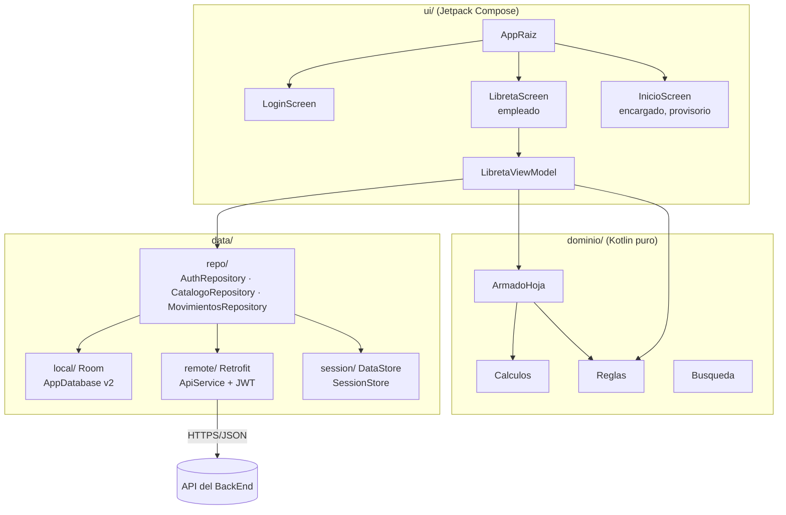
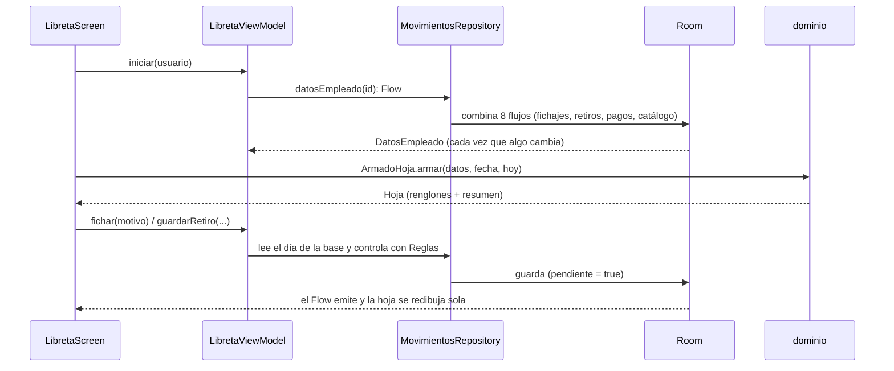

# Arquitectura de la app

## Principios

- **Offline-first.** La libreta funciona sin conexión: todo lo que se muestra sale de la base local (Room)
  y se calcula en el teléfono. La red solo se usa para ingresar y descargar el catálogo (y, desde la
  Fase 4, para sincronizar).
- **La lógica no vive en la UI.** Las reglas y cuentas están en `dominio/`, en Kotlin puro (sin Android),
  replicando `calculos.py` y `reglas.py` del backend con el mismo redondeo y los mismos casos de test.
- **Sin frameworks de inyección.** Un `AppContainer` crea y comparte las dependencias.

## Capas

| Carpeta | Contenido |
|---|---|
| `AgendAppApplication`, `AppContainer`, `MainActivity` | Arranque, dependencias y la única Activity |
| `data/remote/` | `ApiService` (Retrofit), DTOs con kotlinx.serialization, `BigDecimalSerializer`, `ApiError` (traduce `{"detalle": …}`), `Network` (interceptor y renovación del token) |
| `data/local/` | Room: `Entidades.kt`, `Daos.kt`, `AppDatabase.kt` |
| `data/session/` | `SessionStore`: tokens, usuario y fecha de la última descarga (DataStore) |
| `data/repo/` | Repositorios: lo único que la UI conoce de `data/` |
| `dominio/` | `Modelo`, `Calculos`, `Reglas`, `Hoja` (armado de la hoja), `Busqueda` |
| `ui/` | `theme/`, `AppRaiz`, `ViewModels` (fábrica), `login/`, `libreta/`, `inicio/` |
| `util/` | `Formato.kt`: pesos (`$12.533,33`), fechas y horas |

## Flujo de datos de la libreta

- `MovimientosRepository.datosEmpleado()` combina con `combine` los flujos de Room en un único
  `DatosEmpleado` (fichajes, retiros, pagos, tarifas, feriados, horarios, productos y parámetros).
- La pantalla arma cada hoja con `ArmadoHoja.armar()`, en memoria (`remember(datos, fecha)`).
- Las acciones (fichar, retirar, anular, modificar) pasan por el ViewModel, que **vuelve a leer el día
  directo de la base** y aplica las reglas antes de guardar. Un `Mutex` evita guardar dos veces por un
  doble toque.
- Nada se refresca a mano: al guardar, Room emite y la hoja se actualiza.

## Base local (Room)

`AppDatabase` versión **2**. Esquemas exportados en `app/schemas/` (se versionan).

| Tabla | Origen | Notas |
|---|---|---|
| `productos`, `parametros`, `feriados`, `tarifas`, `horarios` | Descarga del catálogo | Se reemplazan en cada descarga; se borran al cerrar sesión |
| `fichajes`, `retiros` | Lo que registra el empleado | id UUID generado en el teléfono; `pendiente = true` hasta sincronizar (Fase 4) |
| `pagos` | Montos recibidos | Llegan del servidor (Fase 4); hoy solo en los datos de ejemplo |

La migración de la v1 a la v2 es destructiva (`fallbackToDestructiveMigrationFrom(1)`) porque la v1 solo
tenía catálogo. **Desde la v2 toda migración tiene que ser real**: en el teléfono ya hay movimientos sin
sincronizar. Ver [Cómo aportar](como-aportar.md#cambios-en-la-base-local).

## Sesión y red

- **Login** (`auth/login/`) devuelve tokens y usuario; se guardan en DataStore. `AppRaiz` muestra la
  libreta al empleado y el inicio provisorio al encargado.
- `AuthInterceptor` agrega `Authorization: Bearer`. `TokenAuthenticator` renueva el token ante un 401
  (una sola renovación a la vez); **sin conexión no cierra la sesión**, y solo la cierra si el refresh es
  rechazado.
- **Descarga del catálogo** (`CatalogoRepository.descargar`): productos activos, parámetros, feriados
  (desde la fecha de alta hasta un año adelante), tarifas y horarios (la semana pasada y los próximos 60
  días). Se hace sola al ingresar y con el botón de actualizar.
- **Cerrar sesión** borra el catálogo pero **no** los movimientos del empleado: si había pendientes, se
  avisa y quedan en el teléfono hasta que vuelva a ingresar.
- La URL del backend sale de `BuildConfig.API_BASE_URL` (ver [Cómo aportar](como-aportar.md#entorno)).

## Lector de códigos

`ui/libreta/Escaner.kt` usa el lector de Google Play Services (`play-services-code-scanner`): abre su
propia pantalla de cámara, no pide permiso de cámara a la app y lee todos los formatos (códigos de barras
y QR). El módulo se descarga una vez; `Escaner.prepararModulo()` lo pide al abrir la libreta para que
después funcione sin conexión.
