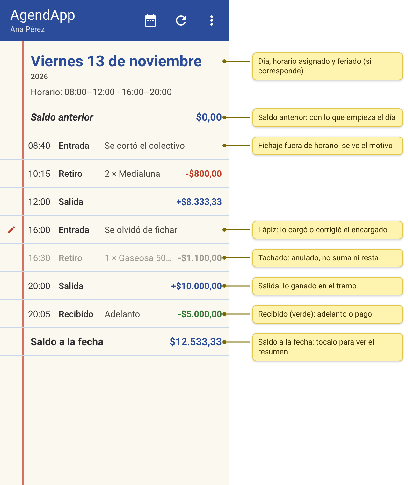
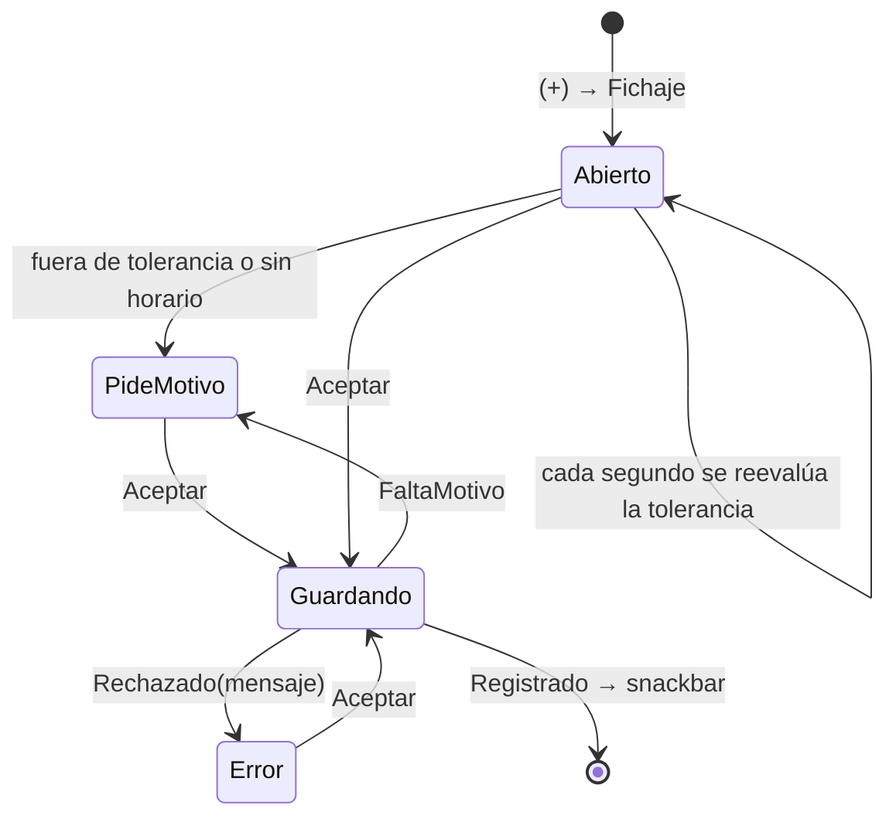

# La libreta (UI)

Todo está en `ui/libreta/`. La metáfora es una **libreta de hojas rayadas**: una hoja por día, con margen
rojo y renglones de 4 columnas (hora, tipo, detalle, monto).

## Archivos

| Archivo | Qué es |
|---|---|
| `LibretaScreen.kt` | La pantalla: barra superior, `HorizontalPager` de días, botón (+) / "Hoy", calendario y el estado de qué popup está abierto |
| `LibretaViewModel.kt` | Datos del empleado (`StateFlow<DatosEmpleado?>`), descarga del catálogo y las acciones: `fichar`, `anularFichaje`, `guardarRetiro`, `anularRetiro`, `productoPorCodigo` |
| `HojaLibreta.kt` | Dibuja una `Hoja`: papel, margen, encabezado y renglones (`RenglonBase` traza la línea azul) |
| `DetalleRenglon.kt` | Popup al tocar un renglón: detalle completo y acciones dentro del plazo (Anular / Modificar) |
| `PopupFichaje.kt` | Popup para fichar, con reloj en vivo. Incluye `rememberAhora()` |
| `PopupRetiro.kt` | Popup para retirar o modificar un retiro: búsqueda, escáner, cantidad, subtotal |
| `Escaner.kt` | Lector de códigos de Google Play Services e `IconoCodigo` |

## Navegación entre días

- `HorizontalPager` con `TOTAL_PAGINAS = 100_000` y la página `PAGINA_HOY = 50_000` como hoy: cada página
  es un día (`hoy + (página − 50.000)`). Deslizar a la izquierda → días siguientes; a la derecha → anteriores.
- El calendario (`DatePickerDialog`) salta a la página de la fecha elegida.
- En la hoja de hoy está el botón **(+)**; en cualquier otro día, **Hoy** vuelve con animación.

## Medidas y colores

| Elemento | Valor | Dónde |
|---|---|---|
| Alto de renglón | 44 dp | `ALTO_RENGLON` |
| Ancho del margen | 36 dp | `ANCHO_MARGEN` |
| Papel / tinta / margen / renglón | `#FBF8EF` / `#2B4C9B` / `#C0392B` / `#C9D6EA` | `ui/theme/Theme.kt` |
| Recibido | `#2E7D32` (verde) | `VerdeRecibido` |
| Anulado | gris `#9E9A90` y tachado | `GrisAnulado` |

Marcas en el margen: **lápiz** rojo = cargado o corregido por el encargado; **punto gris** = pendiente de
sincronizar.

## Popups y sus estados

### Fichar (`PopupFichaje`)

- El tipo (entrada o salida) sale de `Reglas.siguienteTipo`.
- La fecha y la hora no se editan: se registra el momento de tocar **Aceptar**.
- El ViewModel repite todos los controles con los fichajes leídos de la base (`Reglas.controlarFichaje`).

### Retirar o modificar (`PopupRetiro`)

- Sin producto elegido: campo de búsqueda (lupa) con el botón del escáner y la lista filtrada
  (`Busqueda.filtrar`). La lista usa `Column` con scroll y no `LazyColumn`, que no se puede usar dentro de
  un `AlertDialog`.
- Con producto: nombre y precio, **Cambiar**, botones − y + (el + se deshabilita en el tope diario), texto
  del tope y subtotal en positivo.
- Al modificar: el mismo popup con el retiro cargado, la cuenta regresiva del plazo y **Aceptar**
  deshabilitado si vence.
- Resultado del ViewModel: `Guardado(mensaje)`, `SinCambios` (cierra sin aviso) o `Rechazado(mensaje)`.

### Detalle (`DetalleRenglon`)

- Fichaje propio: **Anular** solo si `Reglas.impedimentoParaAnular` es `null`. Si está en plazo pero no es
  el último del día, se explica por qué no se puede.
- Retiro propio: **Anular** y **Modificar** si `Reglas.impedimentoParaCambiarRetiro` es `null`.
- Siempre muestra "Registrado a las HH:MM:SS" y, si hay acciones, "hasta las … (quedan m:ss)".
- Anular pide confirmación en un segundo diálogo.
- Las acciones se recalculan **cada segundo** con `rememberAhora()`: al vencer el plazo desaparecen
  solas. Tocar "Saldo a la fecha" muestra el resumen del día.

## Cómo agregar un tipo de evento nuevo

Ejemplo: mostrar en la hoja un tipo de movimiento nuevo.

1. **Dominio:** agregar el dato en `Modelo.kt` y en `DatosEmpleado`; un valor en `TipoRenglon` con su
   `orden` (debe coincidir con `_ORDEN_TIPO` del backend); armarlo en `ArmadoHoja.armar()` y, si mueve
   plata, sumarlo en `Calculos.dia()`.
2. **Tests** del dominio con el mismo caso que en el backend.
3. **Datos:** entidad y DAO en Room, **con migración** (ver [Cómo aportar](como-aportar.md#cambios-en-la-base-local)),
   y su mapeo `aDominio()` en `MovimientosRepository`.
4. **UI:** color del monto en `FilaEvento` (`HojaLibreta.kt`) y filas del detalle en `contenido()`
   (`DetalleRenglon.kt`).
5. Si el empleado lo puede crear: opción en el menú del (+), popup propio y acción en el ViewModel que
   relea de la base y controle con `Reglas` antes de guardar.

## Textos

Los textos están en castellano rioplatense ("Podés", "Tocá", "Te quedan") y escritos para el empleado:
dicen qué pasó y qué puede hacer ("Ya fichaste a las 08:05. Esperá a que pase el minuto para volver a
fichar."). Los mensajes de reglas compartidas con el backend usan el mismo texto que el servidor.
