# Guía del empleado

AgendApp es tu **libreta de trabajo en el celular**: ahí anotás cuándo entrás y salís y los productos que
retirás. La app calcula sola cuánto ganaste y cuánto te queda por cobrar. **Funciona sin internet.**

> Las imágenes son de referencia: muestran cómo se ven las pantallas, con datos de ejemplo.

---

## 1. Ingresar

Abrí la app y escribí el usuario y la contraseña que te dio el encargado. **Mostrar** deja ver la
contraseña mientras la escribís.

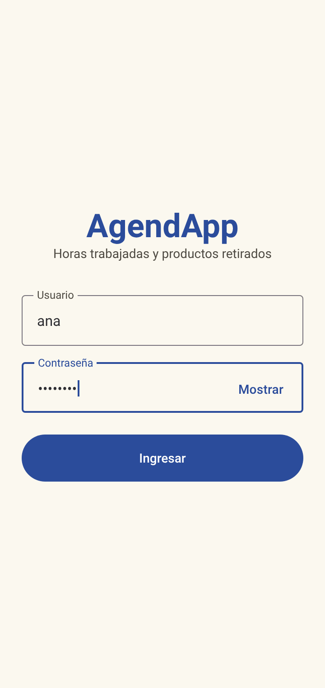

La primera vez necesitás internet: la app descarga tus horarios, tu tarifa y la lista de productos.
Después funciona sin conexión.

---

## 2. Tu libreta

Cada día es una **hoja**. Arriba ves la fecha, tu horario de ese día y, si estás trabajando, desde qué hora.

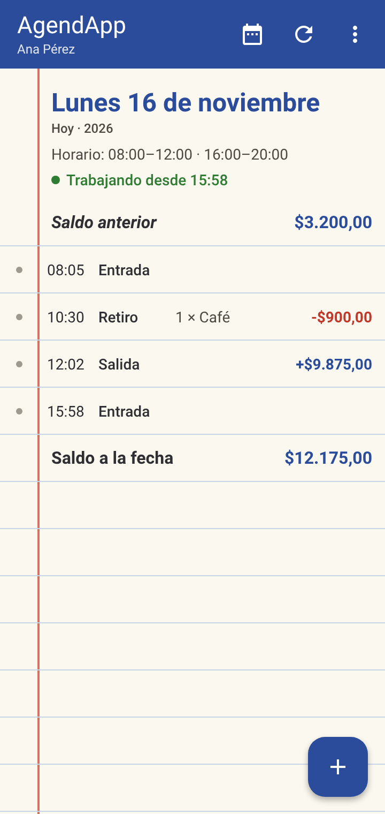

- **Deslizá hacia la izquierda** para ir a los días siguientes, y **hacia la derecha** para ver los anteriores.
- El **calendario** de arriba te lleva a cualquier fecha.
- Si no estás en la hoja de hoy, el botón **Hoy** te trae de vuelta.
- El botón de **actualizar** (la flecha circular) descarga los datos nuevos (por ejemplo, si cambió tu horario).

### Cómo se lee una hoja

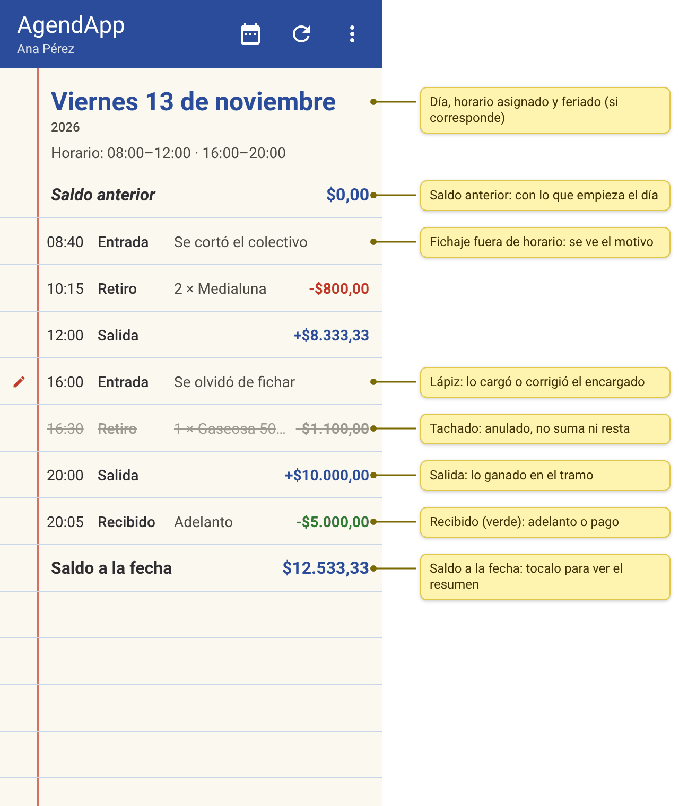

| Renglón | Qué significa |
|---|---|
| **Saldo anterior** | Lo que tenías a favor (o en contra) al empezar el día |
| **Entrada / Salida** | Tus fichajes. En cada salida se ve lo que ganaste en ese tramo |
| **Retiro** | Un producto que retiraste: se descuenta (en rojo) |
| **Recibido** | Plata que te entregaron (un adelanto o un pago), en verde |
| **Saldo a la fecha** | Cómo termina el día: positivo es lo que te deben, negativo lo que debés |

Además:

- Un renglón **tachado** está anulado: no suma ni resta.
- Un **lápiz rojo** en el margen indica que el encargado lo cargó o lo corrigió.
- Un **puntito gris** en el margen indica que todavía no se envió al servidor (ver [Sin internet](#7-sin-internet)).

Tocá cualquier renglón para ver el detalle. Si tocás **Saldo a la fecha**, ves el resumen del día: horas
trabajadas, ganado, productos, recibido y saldo.

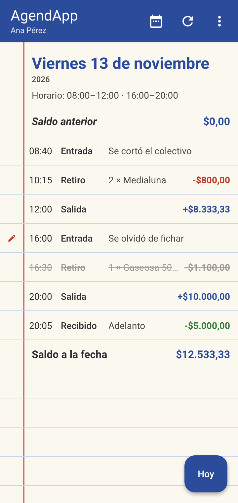 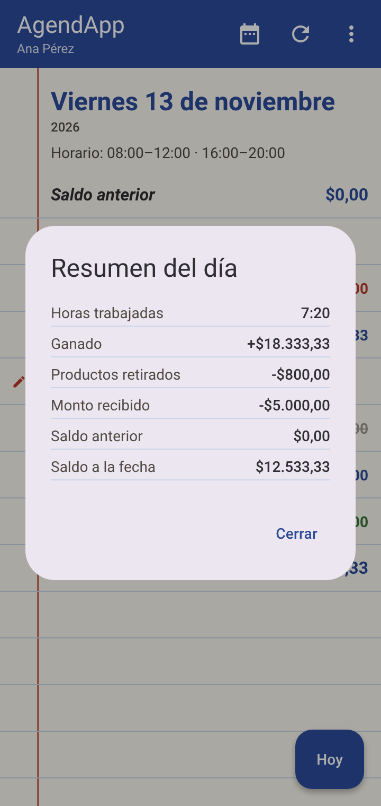

---

## 3. Fichar entrada o salida

En la hoja de hoy tocá el botón **+** y elegí **Fichaje**. La app ya sabe si te toca entrada o salida.

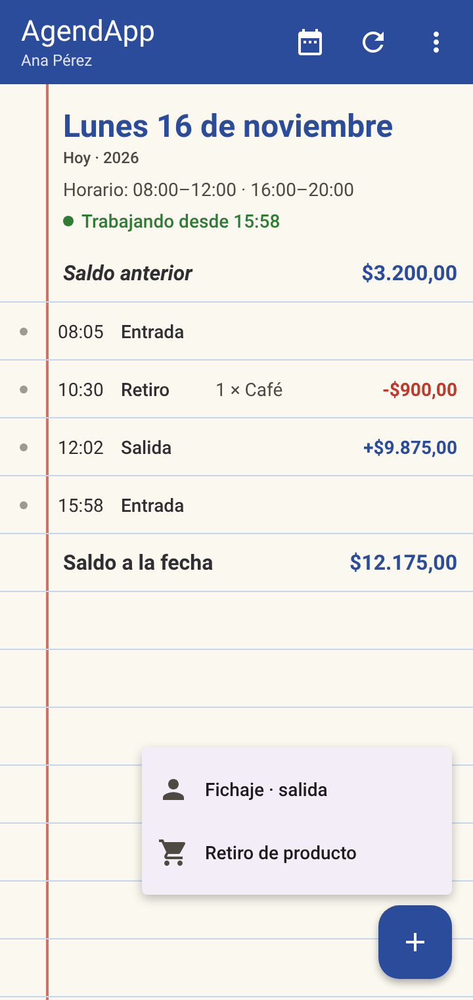

Vas a ver la hora actual (corre en vivo) y la hora esperada según tu horario. Tocá **Aceptar**: se
registra la hora de ese momento.

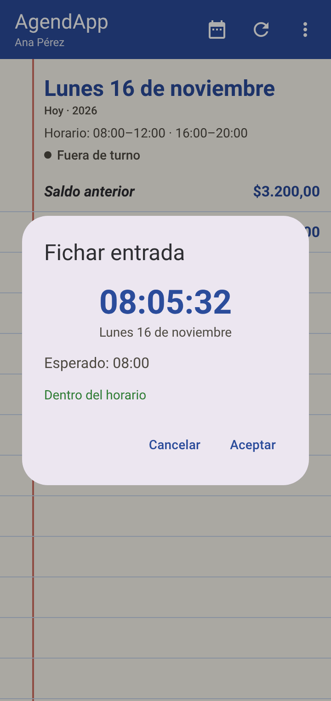

### Si estás fuera de horario

Si fichás **más de 15 minutos** antes o después de tu horario, o un día en que no tenés horario
asignado, tenés que escribir **el motivo** (por ejemplo, "Se cortó el colectivo"). Sin motivo no se
puede aceptar. El encargado recibe el aviso con lo que escribiste.

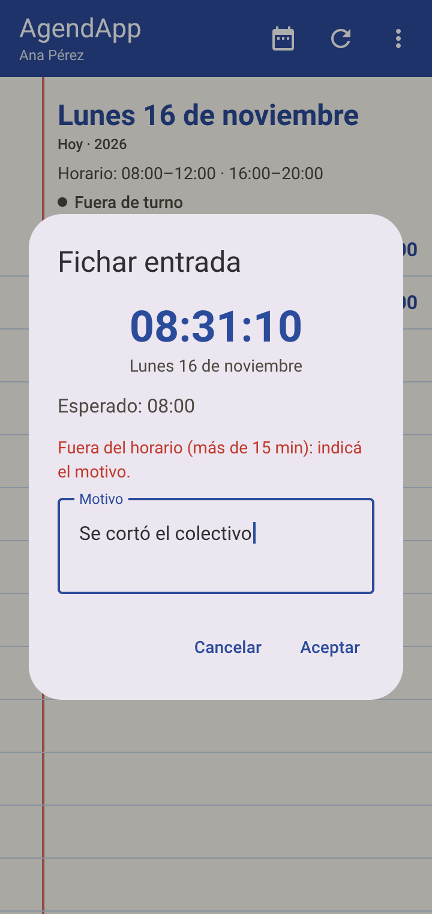

Bueno saber:

- Se paga el **tiempo real** que trabajaste, no el del horario.
- Podés tener **varios tramos** en el día (por ejemplo, mañana y tarde): fichá entrada y salida en cada uno.
- Mientras tenés una entrada sin salida, la hoja dice "Trabajando desde…" y ese tramo suma cuando fiches la salida.
- No se puede fichar dos veces en el mismo minuto. Si la hora del celular quedó atrasada respecto de tu último fichaje, la app te pide revisarla.
- La fecha y la hora no se pueden cambiar a mano.

---

## 4. Anular un fichaje equivocado

Tenés **10 minutos** desde que fichaste para anularlo, y solo el **último** fichaje del día. Tocá el
renglón y después **Anular**; la app te pide confirmar.

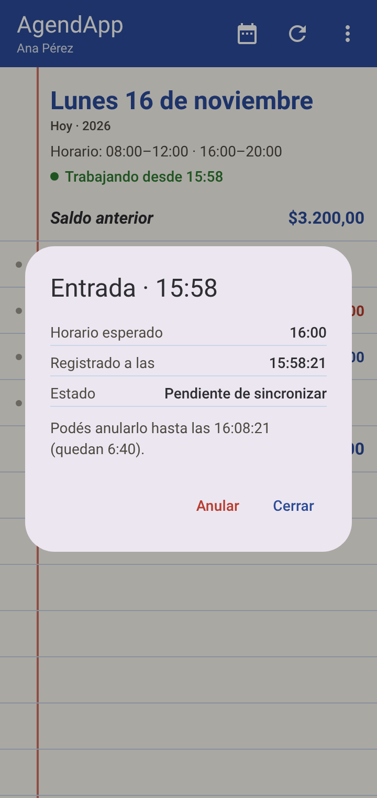

El detalle muestra la hora exacta en que lo registraste y hasta cuándo podés anularlo, con una cuenta
regresiva. Cuando llega a cero, el botón desaparece. Pasado ese tiempo, o si el fichaje lo cargó el
encargado, solo el encargado puede corregirlo: pedíselo.

Un fichaje anulado no se borra: queda **tachado** en la hoja.

---

## 5. Retirar un producto

En la hoja de hoy tocá **+** y elegí **Retiro de producto**.

1. **Buscá el producto**: escribí parte del nombre (no importan mayúsculas ni acentos: "cafe" encuentra
   "Café"), o tocá el **ícono de código de barras** para escanearlo con la cámara.
2. **Elegí la cantidad** con **−** y **+**. Abajo ves cuántas unidades te quedan para hoy: cada producto
   tiene un máximo por día.
3. Revisá el **subtotal** y tocá **Aceptar**.

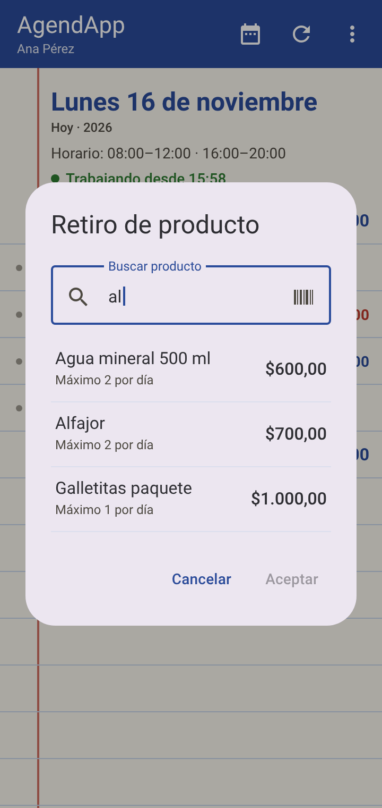 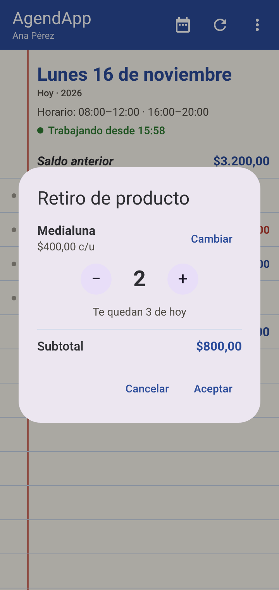

- Se descuenta al **precio que tiene el producto en ese momento**, aunque después cambie.
- La primera vez que usás el escáner, el celular lo descarga (necesita internet esa vez). Mientras
  tanto podés buscar el producto por nombre.
- Si el código no corresponde a ningún producto, la app avisa "Producto no encontrado".

---

## 6. Modificar o anular un retiro

Durante **10 minutos** desde que lo cargaste, tocá el renglón del retiro: podés **Modificar** (cambiar
el producto o la cantidad) o **Anular**. No hace falta justificar.

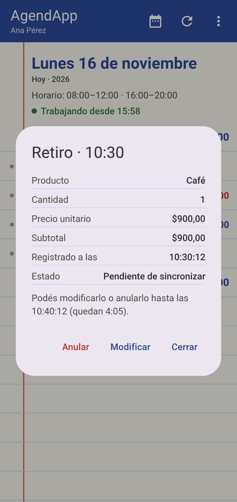 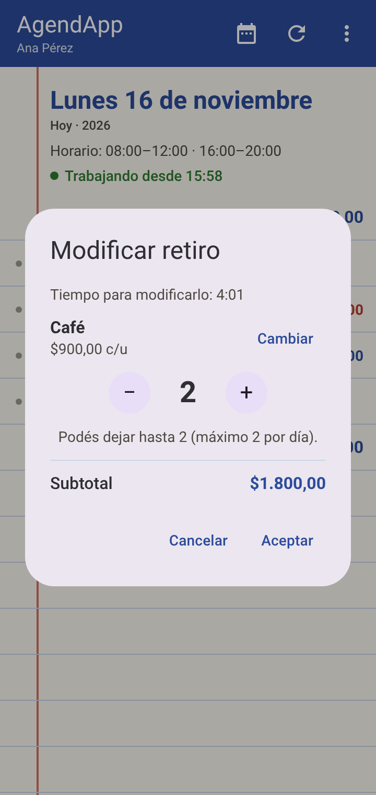

- Si cambiás solo la cantidad, se mantiene el precio original.
- La pantalla de modificar también muestra el tiempo que te queda; si se termina, ya no deja aceptar.
- Pasados los 10 minutos, solo el encargado puede corregirlo.

---

## 7. Sin internet

Podés usar la app **sin conexión**: fichar, retirar y anular se guardan en el celular. Lo que todavía no
llegó al servidor tiene un **puntito gris** en el margen y su detalle dice "Pendiente de sincronizar".

> El envío automático al servidor se está terminando (próxima versión). Mientras tanto todo queda guardado
> en tu celular y no se pierde.

---

## 8. Cerrar sesión

Menú **⋮ → Cerrar sesión**. Si tenés movimientos sin enviar, la app te avisa: quedan guardados en el
celular y se envían cuando vuelvas a ingresar.

---

## Preguntas frecuentes

**Me equivoqué y ya pasaron los 10 minutos.** Avisale al encargado: él lo corrige y en tu hoja aparece
con un lápiz.

**Me olvidé de fichar.** Lo carga el encargado. La app no permite fichar con otra hora que la actual.

**¿Por qué me pide motivo?** Porque fichaste más de 15 minutos antes o después de tu horario, o porque
ese día no tenías horario asignado.

**El "+" no aparece.** Solo está en la hoja de **hoy**. Tocá **Hoy** para volver.

**No me deja retirar más de un producto.** Llegaste al máximo diario de ese producto.

**¿Qué es el saldo negativo?** Que retiraste más de lo que ganaste: se descuenta de lo próximo que
cobres.
